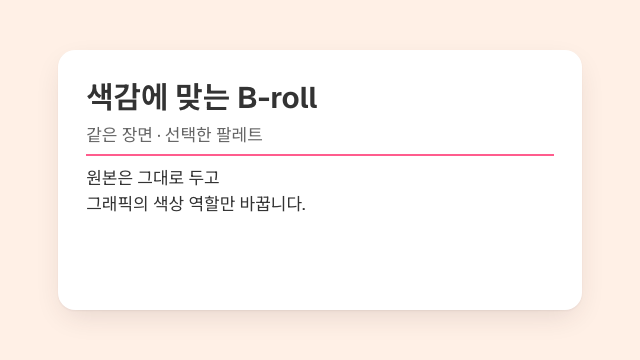
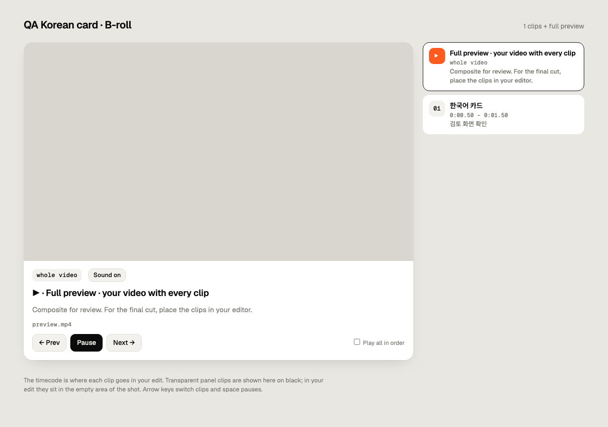

# broll-me QA assessment

**QA-014·QA-015를 포함한 전체 누적 diff 최종 검토에서 추가로 입증된 회귀나 누락을 발견하지 못했습니다. 현재 15건 모두 Resolved를 유지합니다.** Node `beats`의 first-write identity guard와 cleanup 후 rename, Build batch의 temporary name reservation 및 첫 최종 artifact write 경계를 대조했습니다. 최초 반례와 모든 후속 근거를 보존합니다.

| Audit field | Value |
| --- | --- |
| Date | 2026-10-12, Asia/Seoul |
| Source baseline | `2ba30a6cdfa84d7cc3113a5dd3948c8f7a638c18` |
| Initial repository status | 최초 QA: Clean; P1/P2 수정 시작: 기존 변경 보존 |
| Deliverables | QA report, 15 local JIRA-style tickets (original 11 + review findings 4), validation record, 4 evidence images (최초 2개, review UI follow-up 2개) |
| Implementation changes | P1: LICENSE/build input alias/Python and Node media identity; P2: output symlink, build/palette publication, batch destination collisions, alpha accumulation, CLI cancellation/cleanup, embedded notices, portable YAML validation, review keyboard/media state; P3: custom overdamping/checker error wait |

## 1. Executive Summary

**현재 상태: 15건 모두 로컬 Resolved를 유지하며 새 티켓은 없습니다.** Baseline 대비 전체 diff와 관련 caller를 대조했습니다. QA-014의 초기·late identity guard, resource cleanup·rename과 QA-015의 target-filesystem probe·최종 write 순서가 구현·tests·문서 계약에 맞습니다. 임시 이름 예약은 실제 entries를 만들며 첫 최종 artifact write를 보호하는 경계입니다. 이를 pure read-only나 모든 filesystem/race의 보장으로 확대하지 않습니다.

`make check PYTHON=.runtime/motion/.venv/bin/python`은 package 69 files, Python 112 tests 중 110개 통과·2개 생략, Node 29 tests 통과입니다. 생략한 두 항목은 현재 case-insensitive filesystem에서 만들 수 없는 case-only 별도 파일 fixture입니다. 실제 common CLI에서 protected hardlink와 case-equivalent batch의 사전 거부 및 정상 shared batch를 확인했습니다. Current-template viewer/compare 390px·1280px 네 화면과 두 archive exact bytes/extraction도 통과했습니다. 이전 정상 `beats`의 실제 capture는 당시 record로 보존하며 이번에 반복하지 않았습니다.

이번 review에서는 구현과 tests를 수정하지 않았습니다. QA 보고서·티켓·validation record와 CONTRIBUTING만 갱신하며 모든 기존 source/test 변경, LICENSE, media, 네 evidence image·discovery links와 `dist/`를 보존합니다. 실제 host/editor approval와 release는 이번 검증 범위가 아닙니다.

아래 최초 QA의 실패, 렌더링 결과와 evidence는 당시 관찰로 유지합니다. P1/P2/P3 resolution과 현재 검사 결과는 각 ticket의 Resolution 및 이 보고서 마지막 절에 구분했습니다.

Skill 계약, 보안, 파일 전달, 렌더링, 아키텍처, 검토 화면을 검토했습니다. 3개 reviewer가 분담한 결과를 원인과 재현 조건으로 대조했습니다. 동일 대화의 context를 공유한 병렬 검토이며 cold review나 별도 host 평가로 계산하지 않습니다.

최초 QA에서 확정한 항목은 **P1 2개, P2 8개, P3 1개**입니다. P1은 release 준비 차단 또는 입력 손상, P2는 제한된 입력·실패 조건에서의 기능 결함이나 안전성 위험, P3는 기본 preset에 영향이 없는 custom API 제한입니다. P0에 해당하는 근거는 발견하지 못했습니다. 위험이 없다는 보증은 아닙니다.

Python 65개 test는 기본 interpreter에서 64개 통과, NumPy 의존 사례 1개 생략이었습니다. 생략한 사례는 기존 runtime virtualenv로 별도 실행해 통과했습니다. Node 18개 test도 통과했습니다. 이 결과와 별개로 `make check`는 첫 package 단계에서 실패했습니다.

이번 QA는 새 Skill, Custom Subagent 정의, Automation을 만들지 않습니다. 별도 최근 30일 workflow discovery도 이 보고서의 범위가 아닙니다. 과거 기록은 현재 확인할 경로와 검증 경계를 찾는 데만 사용했습니다.

## 2. Scope and current architecture

### Reviewed sources

| Source | Verified scope | Limit |
| --- | --- | --- |
| Current Git checkout | README, CONTRIBUTING, canonical Skill, implementation, examples, tests, package scripts | Source와 로컬 동작의 근거 |
| Existing reports | `ENGINE_IMPROVEMENTS.md`, `NPX_DOCUMENTATION.md`, `DOCUMENTATION.md` | 각 기록의 당시 결과; 현재 성공으로 재사용하지 않음 |
| Local runtime | Python, Node, FFmpeg, FFprobe, Playwright, Chromium | 설치된 고정 profile 검사와 synthetic 실행 |
| Local distribution | Existing `.skill` archive, manifest, discovery links | Live GitHub release나 새 tagged installation의 근거가 아님 |

Go source 또는 `go.mod`는 없습니다. macOS에서 실행하는 Python CLI와 Node browser renderer가 실제 대상입니다.

| Boundary | Current responsibility | Relevant finding |
| --- | --- | --- |
| `SKILL.md` / reference | 입력, creative approval, task 경로, runtime 선택, 종료·복구 계약 | Embedded notices 전달 계약; QA-007 해결 |
| `scripts/broll.py` | 공통 진입점, child 실행, stdout JSON, timeout | Cancellation grace와 bounded group termination; QA-006 해결 |
| `engine/build.py`, `scene_templates.py`, `fonts.py`, `palette.py` | SceneSpec 또는 fragment를 HTML, font, palette bundle로 변환 | Input alias 보호, publication 일관성, notice export |
| `runtime.js`, `render.js`, `check.js`, `motion.js` | Browser seek, 검사, frame capture, encoding, motion 계산 | Alpha accumulation와 custom damping; QA-005/011 해결 |
| `media.py`, `composite.py`, `preview_bundle.py`, templates | 원본 검사, 합성, review bundle publication, 검토 화면 | Publication 보호와 review keyboard/media state; QA-003/009/010 해결 |
| Repository package/evaluation tools | Curated archive, host 발견 경로, 실행 근거 소유권 | LICENSE와 strict portable frontmatter preflight; QA-001/008 해결 |

정본은 `skills/broll-me/`입니다. `.agents/skills/broll-me`와 `.claude/skills/broll-me`는 같은 정본으로 연결됩니다. 이 구조와 기존 공통 CLI를 유지하는 것이 타당합니다. 새 framework나 Go 전환을 뒷받침하는 요구는 확인되지 않았습니다.

## 3. Compact Shortlist

모든 항목의 관찰일은 2026-10-12입니다. 아래 ID는 외부 JIRA issue가 아닌 이 저장소의 로컬 식별자입니다.

### Release and input preservation

| Ticket | Priority | Finding | Evidence | Decision |
| --- | --- | --- | --- | --- |
| [BROLL-QA-001](QA-TICKETS-2026-10-12.md#broll-qa-001) | P1 | Portable Skill의 LICENSE 누락 | 최초 validator 실패; P1 follow-up source/archive 검증 통과 | Resolved, locally verified |
| [BROLL-QA-002](QA-TICKETS-2026-10-12.md#broll-qa-002) | P1 | Build output alias가 input을 손상 | 최초 input 손상; P1 follow-up alias 회귀 검사 통과 | Resolved, locally verified |
| [BROLL-QA-013](QA-TICKETS-2026-10-12.md#broll-qa-013) | P1 | Media output의 case alias가 protected input을 교체 | Actual alias 반례 거부, first-write/rollback 검사와 정상 CLI bundle 통과 | Resolved, locally verified |
| [BROLL-QA-014](QA-TICKETS-2026-10-12.md#broll-qa-014) | P1 | Node beats hardlink output이 HTML input을 truncate | CLI 첫-write 거부·입력 보존, late guard/cleanup 검사, 실제 정상 contact PNG 통과 | Resolved, locally verified |
| [BROLL-QA-015](QA-TICKETS-2026-10-12.md#broll-qa-015) | P2 | Build batch의 case-equivalent output이 첫 scene을 덮어씀 | Case·normalization 예약 충돌 거부, 최종 artifact 보존, 양 font-mode 정상 batch 통과 | Resolved, locally verified |
| [BROLL-QA-003](QA-TICKETS-2026-10-12.md#broll-qa-003) | P2 | Known output type / shared-font 거부 조건을 뒤늦게 검사 | Pure path/font preflight, 다섯 반례의 zero writes/encoder와 정상 재사용 통과 | Resolved, locally verified |
| [BROLL-QA-004](QA-TICKETS-2026-10-12.md#broll-qa-004) | P2 | Build 실패 후 HTML과 palette가 불일치 | Conflict/rollback/recovery 검사와 실제 writer lock 거부 통과 | Resolved, locally verified |

### Rendering and portable artifacts

| Ticket | Priority | Finding | Evidence | Decision |
| --- | --- | --- | --- | --- |
| [BROLL-QA-005](QA-TICKETS-2026-10-12.md#broll-qa-005) | P2 | Final alpha motion blur의 색이 어두워짐 | Filter·ProRes 수치, 실제 Chromium PNG 전환과 decoded frame 수 | Resolved, locally verified |
| [BROLL-QA-006](QA-TICKETS-2026-10-12.md#broll-qa-006) | P2 | CLI timeout 이후 render 임시 폴더 잔존 | 실제 CLI/Chromium/FFmpeg cleanup, prior bytes·PID 종료, bounded force regression | Resolved, locally verified |
| [BROLL-QA-007](QA-TICKETS-2026-10-12.md#broll-qa-007) | P2 | Embedded export에 readable font notice 전문 없음 | Scene/review HTML 전문, shared bytes, missing notice 실패, Chromium pixels | Resolved, locally verified |
| [BROLL-QA-008](QA-TICKETS-2026-10-12.md#broll-qa-008) | P2 | Malformed YAML frontmatter를 package validator가 승인 | 원래·Unicode 반례 거부, 정상 metadata, backend 이전 preflight와 Ruby 비교 | Resolved, locally verified |

### Review interface and custom API

| Ticket | Priority | Finding | Evidence | Decision |
| --- | --- | --- | --- | --- |
| [BROLL-QA-009](QA-TICKETS-2026-10-12.md#broll-qa-009) | P2 | Focused button의 Space 동작을 전역 shortcut이 가로챔 | 실제 native Space·background shortcut·focused seek slider 검사 | Resolved, locally verified |
| [BROLL-QA-010](QA-TICKETS-2026-10-12.md#broll-qa-010) | P2 | Compare waiting 중 영상 진행, Pause 사용 불가 | Active pair pause·시점 보존·manual Play, inactive/stale event 검증 통과 | Resolved, locally verified |
| [BROLL-QA-011](QA-TICKETS-2026-10-12.md#broll-qa-011) | P3 | 허용한 overdamping 값을 무시 | 독립 overdamped 수치, exact legacy samples, custom fragment build/seek/render | Resolved, locally verified |
| [BROLL-QA-012](QA-TICKETS-2026-10-12.md#broll-qa-012) | P3 | Browser checker가 Loading을 error로 오인 | Retry와 exact current source 대기, 원본 checker 네 화면 통과 | Resolved, locally verified |

## 4. Original QA verification and design observations

### Executed checks

| Check / command | Result | Practical limit |
| --- | --- | --- |
| `make check` | **FAIL**, make exit `2`; validator exit `1`, `Required package files missing: LICENSE` | 이후 두 suite는 이 명령 안에서 실행되지 않음 |
| `python3 -m unittest discover -s tests -p 'test_*.py'` | 64 PASS, 1 SKIP / 65 | 생략 이유: 기본 Python에 NumPy 없음 |
| `.runtime/motion/.venv/bin/python -m unittest discover -s tests -p 'test_delivery.py' -k test_dark_frames_do_not_invent_subject_box` | 1 PASS | 생략 사례만 기존 virtualenv로 보완 |
| `node --test tests/*.test.js` | 18 PASS | 일부 browser/encoder 검사는 test double |
| `python3 skills/broll-me/scripts/broll.py --runtime .runtime/motion doctor` | 첫 시도 BLOCKED; 권한 검토 후 PASS | Sandbox MachPort 오류를 환경 차단으로 분리 |
| Card build / check / final render / decode | PASS, 640×360, 1초, 30 frames, H.264, `30/1` | `kkumil-pink` 단일 사례 |
| Panel build / final render / decode | PASS, 640×360, 1초, 30 frames, ProRes alpha | `onnimm-orange` 단일 사례; blur 결함의 부재를 증명하지 않음 |
| Preview composition / decode / audio hash | PASS, 3초, 90 frames; source/preview audio packet hash 동일 | Synthetic source 1개 |
| Viewer / compare, 390px and 1280px | Page error 0, 가로 overflow 없음 | Keyboard와 missing-media 결함은 별도로 재현 |
| Existing evaluation invoker, `words` 2회 | 두 JSONL record 정상 parse | Provider를 호출하지 않은 local helper 확인 |
| Package scratch recovery and roundtrip | LICENSE만 복원한 사본의 69 files PASS | 현재 source나 `dist/`를 수정하지 않음 |

고정 실행 환경은 Python `3.12.14`, Node `24.21.0`, FFmpeg/FFprobe `9.0.2`, Chromium `151.0.7922.34`로 확인했습니다. 새 dependency를 설치하지 않았습니다.

스크린샷 표본에서 한국어 카드의 글자, 줄바꿈, framing은 읽을 수 있었습니다. Viewer는 390px에서 control과 clip 목록이 한 열로 배치됐고, 1280px에서는 player와 목록이 나뉘었습니다. 이 관찰을 전체 팔레트의 contrast 적합성, screen reader 적합성, 전환 전체의 품질 판정으로 확대하지 않습니다.

상세 수치와 조건은 [validation record](qa-2026-10-12-validation.json)에 있습니다. 이미 존재하던 historical reports를 새 결과로 덮어쓰지 않았습니다.

### Checks not run

| Check | Reason | Follow-up |
| --- | --- | --- |
| Current-source packaging / fresh archive install | LICENSE 누락으로 차단; 기존 `dist/` 보존 | QA-001 수정 후 `python3 scripts/package.py`, `python3 scripts/validate_package.py --archive dist/broll-me.skill` |
| Actual Codex / Claude host evaluation | 추가 provider 호출이 필요한 별도 검증 | 로컬 수정 확인 후 필요한 fixture만 승인된 범위에서 실행 |
| Real footage alignment / complete playback / human approval | Synthetic 표본만 사용 | 실제 matching footage와 subtitle, 승인된 slot으로 편집자 검토 |
| Live release / external JIRA registration | 외부 변경은 범위에 포함되지 않음 | 별도 명시적 승인 및 대상 필요 |
| Dedicated lint / typecheck / app build | 해당 repository target이 없음 | 기존 `make check`와 실제 scene build/render가 이번 직접 검증 |

## 5. Counterevidence and exclusions

기존 tests의 성공을 전체 품질로 해석하는 가정은 반례로 기각했습니다. Source LICENSE 검사, input inode alias, alpha 누적, native keyboard activation은 다른 실패 조건을 검증해야 합니다. 반대로 근거 없는 구조 변경은 채택하지 않았습니다.

1. **Basic Skill structure:** 입력, 승인, 경로, 종료, 재시도, evidence 구분이 문서화되어 있습니다. Persona나 자산 종류를 추가하는 것으로 해결할 결함은 발견하지 못했습니다.
2. **Existing safeguards:** Argument array 실행, SceneSpec text escaping, review metadata의 `textContent`, curated archive의 symlink 거부, preview rollback/recovery 보존은 유지할 동작입니다. 이것이 임의 HTML의 안전성을 보증하지는 않습니다.
3. **Evaluation logging suspicion:** INVOKER newline escaping은 실제 local helper 2회 실행에서 정상 JSONL로 확인했습니다. 결함으로 등록하지 않았습니다.
4. **Undocumented periodic track:** `M.track`의 내부 loop 경계 차이는 관찰됐지만 공개 guide나 shipped example에 사용이 없습니다. 현재 사용자 영향이 부족해 formal ticket에서 제외했습니다.
5. **Unrequested automation / rewrite:** 새 Skill, Subagent definition, Automation, CI framework, Go migration은 필요 근거가 없습니다. 이번 QA 결과를 핑계로 추가하지 않습니다.

## 6. Original QA documentation and repository status

README 두 언어와 CONTRIBUTING에 현재 QA 경로를 추가했습니다. Workflow 두 언어에서 embedded mode가 full font notice를 자동 포함한다는 설명을 실제 동작에 맞게 정정했습니다. Export 구현은 미수정이며 QA-007은 open입니다.

| Change group | Files / scope |
| --- | --- |
| New reports | `QA-2026-10-12.md`, `QA-TICKETS-2026-10-12.md`, `qa-2026-10-12-validation.json` |
| Evidence images | `qa-2026-10-12-assets/card.png`, `viewer-missing.png` |
| Discovery documentation | `README.md`, `README.ko.md`, `CONTRIBUTING.md` |
| Current behavior clarification | `skills/broll-me/reference/workflow.md`, `workflow.ko.md` |

초기 `git status --short`는 비어 있었습니다. 최종 변경은 위 문서와 QA evidence뿐이며 executable source, tests, runtime profile, root LICENSE, 기존 `dist/`와 사용자 media는 변경하지 않았습니다. Commit과 push는 수행하지 않았습니다.

최종 `git status --short`는 기존 문서 5개를 `M`으로, 보고서 2개와 validation JSON, evidence directory를 `??`로 표시합니다. Tracked diff는 9 insertions, 2 deletions입니다. Untracked output은 새 Markdown 2개, JSON 1개, PNG 2개로 별도 검토했습니다. `git diff --check`, local Markdown target/anchor 검사, 11개 ticket의 Current State / Expected State / Acceptance Criteria 확인, JSON parse를 통과했습니다. 최종 source package 검사도 LICENSE 누락으로 계속 실패했습니다.

문서는 `i-have-adhd`, `humanizer`, `grammar-checker`, `style-guide` 기준으로 수동 검토했습니다. ISO 날짜, ticket ID, Current State / Expected State, PASS / FAIL / BLOCKED / NOT_RUN 용어를 통일했습니다. 수치, 원인 방향, 부정, 인용, 핵심 판정, 격식의 의미 보존 6항을 확인했습니다. 자동 한국어 점수나 법적 검토 결과를 부여하지 않았습니다.

## 7. Original QA risks, assumptions and decisions

`change_risk`는 문서 변경에 대해 **low**입니다. 변경은 Git diff로 확인하고 되돌릴 수 있습니다. 검토 대상 구현에는 입력 손상과 publication 실패 노출이 있으므로 ticket priority를 문서 변경 위험과 구분합니다. `execution_advice`는 **standard capability / thorough intent**입니다. 통상적인 repository reasoning으로 검토할 수 있지만 파일 identity, child lifecycle, alpha 계약의 경계를 재확인해야 하므로 기본 measured보다 숙고 범위를 넓혔습니다. 사용자 model/effort 설정은 변경하지 않았으며 모델 강도로 실행 검증을 대신하지 않았습니다. 실제 host·filesystem concurrency의 새 근거가 나오면 해당 위험과 검증 범위를 다시 평가해야 합니다.

- `[Verified]` 원본 hard link 손상, package 실패, alpha RGBA 수치, keyboard 동작, missing-media 화면은 직접 재현했습니다. Controlled interleaving와 timeout screenshot stub의 범위는 각 티켓에 별도로 적었습니다.
- `[Assumption]` 현재 repository가 QA 대상이며, 실행은 이미 준비된 고정 runtime과 synthetic local input으로 제한합니다. 실제 release와 다른 workspace는 판정하지 않습니다.
- `[Inference]` 반복 timeout은 임시 렌더 파일을 누적시킬 수 있습니다. 실제 Chromium orphan이 장기간 남는지는 확인하지 않았습니다.
- `[Unverified]` 기존 public release의 현재 상태, 실제 host의 전체 workflow, real footage synchronization, 전체 접근성, 최종 human approval은 확인하지 않았습니다.
- **Pending decisions:** Direct output symlink를 거부할지 explicit 지원할지, custom overdamping을 지원할지 범위를 제한할지는 구현 전에 결정해야 합니다. Embedded notice는 법적 적합성 판정이 아닌 확인된 output 계약 결함입니다.

문서 작성과 로컬 검증에는 추가 승인이 필요하지 않았습니다. Dependency 추가, 실제 release, push, external tracker write, scheduler activation은 수행하지 않았으며 요청될 경우 해당 대상을 정한 후 승인받아야 합니다.

## 8. Original QA accounting and follow-ups

### Created or Extended

QA report 1개, JIRA 형식의 로컬 ticket 문서 1개에 11개 항목, validation record 1개와 evidence image 2개를 만들었습니다. 기존 문서 5개를 갱신했습니다. 구현 수정은 0개입니다.

### Deliberately Skipped

새 workflow 자산, undocumented loop의 formal ticket, dependency 설치, implementation fix, external registration, commit, push, release와 Automation 활성화를 제외했습니다.

### More Evidence Required

최초 QA에서는 실제 host 재검증, source 수정 후 archive installation, 실제 footage와 human review, production/public release 상태, real Chromium timeout cleanup에 추가 근거가 필요했습니다. 이후 bounded Chromium timeout 사례는 아래 runtime follow-up에서 확인했습니다. 나머지 항목과 forced detached descendant cleanup은 추가 근거가 필요합니다. 각 조건은 관련 티켓과 검증 표에 적었습니다.

### P1 follow-up — 2026-10-12

사용자가 요청한 QA-001/002만 수정했습니다. 최초 QA의 5개 문서 변경과 보고서·이미지를 보존했습니다. Root LICENSE와 기존 `dist/` bytes도 보존했습니다. 새 dependency, external issue write, commit, push와 release는 없습니다.

| Change | Result |
| --- | --- |
| `skills/broll-me/LICENSE` | Root와 동일한 내용을 복원; portable package의 내부 참조 해결 |
| `engine/build.py` | Input file identity/hard link 검사, output symlink 거부, 임시 HTML 작성 후 lexical entry 교체 |
| `tests/test_palette.py` | 기존 suite에 input alias, batch alias, symlink, controlled publication 반례 4개 추가 |
| Related documentation | Usage/troubleshooting의 alias 복구 안내, CONTRIBUTING과 두 P1 ticket 상태 갱신 |

| Verification | Result / boundary |
| --- | --- |
| `make check PYTHON=.runtime/motion/.venv/bin/python` | PASS: package 69 files, Python 69 tests, Node 18 tests; skip 없음 |
| `python3 scripts/package.py --output <scratch>/package` | PASS: stdlib-curated `.skill`/`.zip`, exact source bytes와 extraction |
| Extracted LICENSE/internal references | PASS: 두 archive에서 root LICENSE와 동일 |
| Existing artifacts and scope | Root LICENSE, 기존 `dist/`, QA images 및 수정과 무관한 기존 파일 보존 |
| New browser/render/actual host invocation | NOT_RUN: scene 내용·renderer 변경 없음; filesystem/packaging 수정의 최소 검증에 포함하지 않음 |

새 package는 로컬 임시 위치에서만 만들었습니다. Working tree 변경은 아직 commit하지 않았으므로 별도 resolution commit SHA는 없습니다. [P1 validation record](qa-2026-10-12-validation.json)의 source digest와 검사 command가 실행 시점을 식별합니다. Package에 포함되는 문서 수정 후 source/archive 검증도 다시 통과했습니다.

P1 수정 당시 file identity 검사와 atomic HTML publication으로 입력 inode 손상을 막았습니다. 그 시점에는 공동 publication과 direct media symlink를 포함한 P2/P3 ticket이 남아 있었습니다. 다음 절은 이후 P2 파일 안전성 수정 결과입니다.

### P2 file-safety follow-up — 2026-10-12

QA-003/004만 추가 수정했습니다. 이전 P1 수정, README·paired workflow, LICENSE, 기존 archive와 QA images를 보존했습니다. 두 파일의 일괄 atomic visibility나 모든 QA 완료를 주장하지 않습니다.

| Change | Result |
| --- | --- |
| Media publication | Lexical output/parent symlink 검사, publication 전 재검사, 원래 directory에 고정한 cleanup |
| Affected callers | Inspection/review/preview가 선택한 output alias를 검사하며 readable input symlink는 유지 |
| Build / palette | 공유 `.broll-palette.lock`, publication 직전 재검사, 새 snapshot ownership 기반 rollback |
| Recovery | Retained stage/lock과 실제 publication 상태를 보고; 자동 stale reclaim 없음 |
| Documentation | Skill, usage, troubleshooting, CONTRIBUTING과 두 QA ticket 상태 갱신 |

| Verification | Result / boundary |
| --- | --- |
| `make check PYTHON=.runtime/motion/.venv/bin/python` | PASS: package 69 files, Python 79 tests, Node 18 tests; skip 없음 |
| Existing test additions | Delivery 7개, palette 3개와 예약 snapshot 이름 충돌 subcase |
| Cooperating child writers | 실제 build/palette child 2개가 보유 중인 lock에서 거부됨; 해제 후 정상 build 완료 |
| Controlled failure cases | 충돌 snapshot, HTML publication 실패, 기존 snapshot bytes/mtime, rollback 실패와 retry 차단 확인 |
| Source/archive and scope | 임시 archive 검증; root/portable LICENSE, 기존 `dist/`, 변경과 무관한 파일 보존 |

Build가 생성한 snapshot만 실패 시 제거합니다. Unmanaged writer가 충돌하는 snapshot을 만들었으면 그 파일을 지우거나 되돌리지 않고 기존 HTML을 보존하며 실패를 알립니다. Cleanup은 일관된 output이 publish된 뒤 실패할 수도 있으므로 오류 시 파일 상태를 확인해야 합니다.

`.broll-palette.lock`은 cooperating build/palette writers를 조정합니다. Busy/recovery lock에서 즉시 실패하고 자동 삭제하지 않습니다. 두 파일의 atomic visibility, 전체 batch transaction, hostile parent-directory race와 sudden OS exit는 `NOT_RUN`입니다. 새 browser/render/actual host 평가는 filesystem 검증 범위에 포함하지 않았습니다. 새로운 dependency, commit, push, release나 외부 티켓 등록은 없습니다.

세부 command, source digest와 보존 확인은 [P2 validation record](qa-2026-10-12-validation.json)의 `p2_file_safety_follow_up`에 있습니다. 이 파일 안전성 수정 직후 Remaining open은 7건이었습니다.

### P2 rendering/runtime follow-up — 2026-10-12

QA-005/006만 추가 수정했습니다. 이전 P1·파일 안전성 구현과 tests, README, LICENSE, 기존 `dist/` 및 QA images를 보존했습니다. 새 dependency, framework, standalone test infrastructure, commit, push, release와 external tracker write는 없습니다.

| Change | Result |
| --- | --- |
| Final alpha | 16-bit premultiplied accumulation 후 straight alpha 복원; zero/low alpha와 mixed color 보존 |
| PNG capture | Alpha final의 `-reinit_filter 0`으로 RGB24/RGBA 전환 중 누적·선택 상태 유지; draft/opaque filter 유지 |
| CLI timeout | POSIX child session, `SIGTERM`과 5초 cleanup grace, 남은 owned group force, bounded capture/reap |
| Renderer cleanup | Abort-aware capture/open, encoder/browser 각각 정리, cleanup 후 publication; 실패·미확인 상태 명시 |
| Documentation | Skill, usage, troubleshooting, paired workflow, CONTRIBUTING, QA ticket/status와 validation record 갱신 |

| Verification | Result / boundary |
| --- | --- |
| `make check PYTHON=.runtime/motion/.venv/bin/python` | PASS: package 69 files, Python 84 tests, Node 21 tests, skip 없음 |
| Alpha numeric/codec regression | PASS: white quarter coverage `[255,255,255,64]`, zero alpha, low alpha, mixed color와 opaque; channel tolerance ≤2 |
| Real PNG format transition | PASS: RGB→RGBA, 역방향과 alternating; 12 captures→3 ProRes frames, `30000/1001` |
| Actual Chromium final/decode | PASS: 64×64, 0.1초 MP4/MOV 각 3 frames, `30/1`; alpha 첫 pixel `[255,255,255,128]` |
| Actual CLI timeout | PASS: 3초 deadline, 약 3.113초 후 JSON/exit `124`, observed Node·Chromium·FFmpeg PID 모두 종료, stage 없음, input/prior output hash 보존 |
| Cancellation failure coverage | PASS: capture/cleanup 중 취소, resource cleanup 오류, opening cleanup 오류 전파, inherited pipe descendant force의 bounded return |
| Source/archive and scope | PASS: 임시 `.skill`/`.zip` exact bytes와 extraction; 이전 구현·LICENSE·dist·이미지 보존 |

첫 실제 alpha spot check에서 filter reinitialization 때문에 3 captures groups가 2 encoded frames로 줄어들고 white coverage가 사라졌습니다. Fixed viewport의 format 변경을 허용하면서 상태를 유지하는 input option을 추가한 뒤 같은 사례를 재실행해 통과했습니다. 중간 renderer test에서 screenshot 변수의 loop index shadowing도 발견해 수정한 뒤 suite를 다시 통과했습니다. 임시 검증 script의 문법·process name assertion 오류는 제품 오류와 구분해 정정했습니다.

Force는 JavaScript cleanup을 실행하지 못하며 detached descendant와 non-POSIX cleanup은 보장하지 않습니다. Cleanup 진단이 없거나 실패한 경우 보고된 stage와 해당 실행의 process를 확인해야 합니다. Human playback, 실제 host/provider 평가, 다른 runtime 버전, OS crash와 모든 shutdown race는 `NOT_RUN`입니다. 별도 lint/typecheck target은 없으며 기존 package/test 검사와 실제 runtime 실행을 사용했습니다.

이번 동작 변경은 `change_risk: moderate`입니다. Alpha와 child lifecycle의 실패 조건을 직접 확인했으며 read-only source reviewer의 범위 검토도 받았습니다. 같은 parent context를 공유한 검토이므로 independent cold review로 계산하지 않습니다. `execution_advice: standard capability / thorough intent`를 유지하고 사용자 model 설정은 변경하지 않았습니다.

이 렌더링·런타임 수정 직후 Remaining open은 **5건(P2 4건, P3 1건)**이었습니다. 세부 command, source digest와 보존 확인은 [validation record](qa-2026-10-12-validation.json)의 `p2_render_runtime_follow_up`에 있습니다.

### P2 delivery/packaging follow-up — 2026-10-12

QA-007/008만 추가 수정했습니다. 이전 P1·파일 안전성·renderer/runtime 구현, README, LICENSE, 기존 `dist/`와 QA images를 보존했습니다. 기존 `test_palette.py`의 offline assertion만 notice 주석의 원문 URL을 허용하도록 조정했으며 나머지 기존 검사와 구현은 유지합니다. 새 production dependency, framework, test infrastructure, commit, push, release와 external tracker write는 없습니다.

| Change | Result |
| --- | --- |
| Embedded font notices | 이름이 붙은 CSS 주석에 두 OFL 전문 포함; HTML/CSS terminator를 가역 인코딩; visible DOM 추가 없음 |
| Required notices | Shared/embedded에서 missing/empty notice 거부; shared 5 assets의 원문 bytes와 충돌 시 보존 유지 |
| Portable frontmatter | Single-line strings와 flat metadata map의 명시된 subset; quote, delimiter, active nesting, duplicate/type 검사 |
| YAML whitespace | 구문 공백을 ASCII space로 제한; Unicode content는 보존하고 잘못된 quote tail·pseudoindent를 거부 |
| Packaging boundary | 기존 `collect_files()` preflight를 backend discovery/creator 실행/output publication보다 먼저 유지 |

| Verification | Result / boundary |
| --- | --- |
| `make check PYTHON=.runtime/motion/.venv/bin/python` | PASS: package 69 files, Python 90 tests, Node 21 tests; skip 없음 |
| Regression additions | Delivery 3개, package 3개 method와 정상/실패 subcases; 기존 palette offline assertion 갱신 |
| Actual HTML exports | PASS: CLI embedded scene, generated viewer/compare에서 두 full notices 원문 대조; shared bytes 확인 |
| Missing-notice build | PASS: export 거부, 이전 HTML bytes와 directory entries 보존 |
| Actual Chromium | PASS: 640×360 `seek(0.5)`에서 embedded/notice 제거본/shared pixels 동일; 세 font의 weight 500 로딩과 review resource/page 오류 없음 |
| Ruby YAML comparison | PASS: 두 원래 반례·Unicode syntax 반례 거부, 정상 metadata/Unicode content 승인; name 뒤 NBSP는 별도 schema 위반으로 거부 |
| Backend preflight | PASS: creator 없음/경로 있음 모두 malformed 입력에서 discovery와 invocation 전 거부, 기존 archives/manifest 보존·새 output 없음 |
| Temporary stdlib archive | PASS: 69 files exact bytes와 extraction round-trip; 기존 `dist/` 미교체 |

첫 `make check`에서는 OFL 전문에 있는 URL을 기존 no-URL assertion이 잘못 거부했습니다. Named notice 주석만 검사 대상에서 제외한 뒤 통과했습니다. 실제 browser 검증도 notice URL을 resource request로 처리하지 않았습니다. Read-only reviewer가 발견한 Unicode whitespace 승인 오류는 ASCII 구문 공백 처리와 regression을 추가한 후 Ruby 비교 및 전체 검사에서 재확인했습니다. Browser 검증 script의 첫 font check는 사용하지 않은 기본 weight를 요구했으므로 bundled weight 500을 명시해 실제 font 로딩을 확인했습니다.

실제 creator backend는 기본 Python과 pinned virtualenv 모두 PyYAML이 없어 `NOT_RUN`입니다. 새 의존성을 설치하지 않고 동일 preflight가 backend 실행보다 먼저 적용되는 경계를 확인했습니다. Full YAML parser, actual host loading, 법률 검토, 다른 browser/runtime와 편집자의 전체 playback 승인은 `NOT_RUN`입니다. 별도 lint/typecheck target이 없으므로 기존 package/tests와 실제 artifact/browser 확인을 사용했습니다.

이번 동작 변경은 `change_risk: moderate`입니다. Notice 누락과 host loading 실패를 막는 계약 변경이며 로컬 diff로 되돌릴 수 있습니다. `execution_advice: standard capability / thorough intent`는 quote/whitespace/HTML parser 경계의 반례를 재확인할 필요에 근거합니다. Read-only reviewer는 같은 parent context를 공유했으므로 independent cold review로 계산하지 않습니다. 사용자 model 설정은 변경하지 않았습니다.

문서는 `i-have-adhd`, `humanizer`, `grammar-checker`, `style-guide` 기준으로 검토했습니다. Current State의 최초 반례와 Resolution의 현재 결과를 구분하고 수치·날짜·고유명사, 인과관계, 부정, 인용, 핵심 판정과 격식의 의미를 보존했습니다.

이 배포·패키징 수정 직후 Remaining open은 **3건(P2 2건, P3 1건)**이었습니다. 세부 command, source digest와 보존 확인은 [validation record](qa-2026-10-12-validation.json)의 `p2_delivery_packaging_follow_up`에 있습니다.

### P2 review UI follow-up — 2026-10-12

QA-009/010만 추가 수정했습니다. 이전 P1·P2 구현, tests, README, LICENSE, 기존 `dist/`와 최초 QA evidence를 보존했습니다. 새 dependency, framework, test infrastructure, commit, push, release와 external tracker write는 없습니다. 기존 browser checker를 확장했습니다.

| Change | Result |
| --- | --- |
| Keyboard scope | Native/ARIA/editable controls 및 이미 처리한 event 제외; background shortcut 유지 |
| Compare seek slider | 자체 Arrow ±2초를 한 번 처리; Space는 playback을 toggle하지 않음; duration/focus 표시 반영 |
| Media state | Actual events와 playback Promise로 label·transport 상태 갱신; loading/error의 false Pause 제거 |
| Recovery | Failed reference를 textContent로 표시, local Retry; viewer clip 선택 유지, compare review time 보존 |
| Failure ordering | Viewer generation과 compare epoch/active pair로 stale failure와 반복 play 재시도 차단 |

| Verification | Result / boundary |
| --- | --- |
| `make check PYTHON=.runtime/motion/.venv/bin/python` | PASS: package 69 files, Python 90 tests, Node 21 tests, skip 없음 |
| Actual generated pages | PASS: existing `make_pages.py`, shared font assets와 synthetic MP4 fixture |
| `scripts/check_review_pages.js <pages> <report>` | PASS: 4 normal/keyboard page·viewport combinations (390px/1280px), page errors·normal overflow 없음; error/retry는 390px에서 확인 |
| Native keyboard | PASS: Sound, viewer Prev/Next/list/Auto, compare layout; background Space/arrow, focused slider 단일 2초 이동 |
| Media failures | PASS: missing MP4와 unsupported bytes의 visible reference/error, disabled transport, 정상 clip 선택과 restored file Retry |
| Controlled Promise ordering | PASS: compare pending sibling+NotAllowed, 이후 Play와 약 2초 Retry; viewer Next 뒤 이전 generation rejection 무시 |
| Error presentation | 두 mobile screenshot을 시각 확인; 기존 tokens/font와 wrapping 사용, healthy 상태에 error row 숨김 |
| Temporary archives | PASS: 69 files exact source bytes와 extraction round-trip, 기존 `dist/` 보존 |

검사 script의 기존 literal-metadata flow가 남긴 layout, clip marker 범위, 아직 필요하지 않은 Korean font, playing/seek readiness를 명시한 뒤 같은 browser 검사를 통과했습니다. 실패 source fixture도 선택한 manifest entry와 일치시켜 stale-source 보호를 우회하지 않았습니다. 이 중간 fixture/assertion 실패를 제품 결함으로 계산하지 않았습니다. Read-only source review와 별도 Chromium page context의 controlled fault 확인에서 남은 blocker는 발견하지 못했습니다. 같은 parent context를 공유했으므로 independent cold review로 계산하지 않습니다.

실제 missing/unsupported file과 정상 playback/keyboard/Retry는 browser/media event 근거입니다. NotAllowed와 pending/stale Promise 검사는 controlled rejection이며 실제 autoplay policy 거부 또는 모든 codec decoder failure를 증명하지 않습니다. Screen reader, 전체 WCAG 적합성, 다른 browser/OS, 실제 host 평가와 사람의 전체 편집 승인은 `NOT_RUN`입니다. Renderer 변경이 없어 추가 scene render/encoding은 실행하지 않았습니다. 기존 unit/package 및 해당 browser 검사를 사용했으며 별도 lint/typecheck target은 없습니다.

이번 변경은 `change_risk: moderate`입니다. Keyboard와 review playback의 observable behavior를 바꾸지만 source/media 파일은 수정하지 않습니다. Native activation·event ordering을 재확인해야 하므로 `execution_advice: standard capability / thorough intent`를 유지했습니다. 문서는 `i-have-adhd`, `humanizer`, `grammar-checker`, `style-guide` 기준으로 검토했고 날짜·수치·원인·부정·판정과 격식을 보존했습니다.

이 review UI 수정 직후 Remaining open은 **1건(P3 QA-011, damping 지원 범위 결정)**이었습니다. 당시 API 구현은 변경하지 않았습니다. 세부 command, source digest와 보존 확인은 [validation record](qa-2026-10-12-validation.json)의 `p2_review_ui_follow_up`에 있습니다.

### P3 custom-overdamping follow-up — 2026-10-12

사용자는 기존 custom fragment 입력을 보존하고 overdamping 값을 실제 계산에 반영하는 방식을 선택했습니다. QA-011만 추가 수정했으며 이전 P1/P2 구현·tests, README, LICENSE, 기존 `dist/`와 evidence를 보존했습니다. 새 dependency, framework, test infrastructure, commit, push, release와 external tracker write는 없습니다.

| Change | Result |
| --- | --- |
| `M.S` | `z > 1`의 zero-initial-velocity unit-step response; normalized roots, small-value series와 expm1로 안정성 보완 |
| Compatibility | `[w,z]`, scene spring/camSpring, default/per-key tracks, colors와 validation 범위 유지; 기존 preset/reset branch 변경 없음 |
| Existing Node coverage | Numeric oracle, monotone/critical limit, exact legacy/reset, custom track·color·config 회귀 4개 추가 |
| Documentation | Engine API에 세 damping 범위, edge cases와 timing 변화 안내; usage 링크, CONTRIBUTING·QA 상태 갱신 |

| Verification | Result / boundary |
| --- | --- |
| `make check PYTHON=.runtime/motion/.venv/bin/python` | PASS: package 69 files, Python 90 tests, Node 25 tests, skip 없음 |
| Focused `tests/palette.test.js` | PASS: 7 tests, skip 없음 |
| Independent root numeric probe | PASS: Decimal 800자리 reference 14개; 선택 사례 최대 absolute error 약 1.74e-18 |
| Read-only math review | PASS: 추가 19개 선택 입력의 수식·정밀도 비교; production blocker 없음 |
| Exact legacy comparison | PASS: 6 presets와 z=0/.999/1, 7 time samples의 총 63개가 이전 구현과 Object.is 일치 |
| Actual custom fragment | PASS: 320×180, T=1, spring/camSpring [1,2], CLI build/check와 Chromium seek-order 재현 |
| Draft render/decode | PASS: H.264 MP4 3 frames, 3/1 FPS; 단일 custom scene의 smoke check |
| Temporary archives | PASS: 69 files exact source bytes와 extraction round-trip; 기존 dist 보존 |

이전 `M.S(1,1,2)`는 critical 값과 같았지만 수정 후 약 `0.1777365761`입니다. 실제 scene의 1초 width는 `124.883px`, camera scale은 `1.08887`로 그 response를 반영했습니다. `z <= 1`과 presets의 기존 계산은 정확히 유지되며 `z > 1` scene은 요청한 damping에 맞춰 timing이 달라집니다. 기존 fragment/output을 자동 수정하지 않았습니다.

수치 검증은 선택한 finite 입력에 한정됩니다. 최소 subnormal 경계에서는 1 ULP 수준의 underflow가 가능합니다. 기존 period residue 알고리즘은 범위 밖이며 정확한 periodicity나 임의 정밀도를 새로 보장하지 않습니다. 전체 custom fragment, 실제 host, human playback/editor approval, 모든 browser/runtime와 release는 `NOT_RUN`입니다. Renderer 자체가 바뀌지 않았으므로 전체 media/browser matrix를 반복하지 않았습니다. 별도 lint/typecheck target은 없으며 기존 tests/package와 관련 CLI 실행을 사용했습니다.

이번 변경은 `change_risk: moderate`입니다. 기존 syntax와 정상 default 동작은 보존하지만 custom overdamped timing을 바로잡는 observable change입니다. 근처 critical·작은 값·큰 finite 값의 수치 경계를 재확인해야 하므로 `execution_advice: standard capability / thorough intent`를 유지했습니다. Same-parent-context reviewer 검토이며 independent cold review로 계산하지 않습니다. 문서는 요청한 writing Skills 기준으로 수치·날짜·인과·부정·판정과 격식을 보존했습니다.

이 P3 수정 직후 Remaining open은 **0건**이었으며, 당시 로컬 QA 티켓 11건은 모두 해결 상태였습니다. 세부 command, source digest와 기존 파일 보존 확인은 [validation record](qa-2026-10-12-validation.json)의 `p3_overdamping_follow_up`에 있습니다. 전체 release readiness와 실제 host·human approval는 별도입니다.

### Final cumulative diff review before follow-up fixes — 2026-10-12

최초 QA 기준 revision `2ba30a6cdfa84d7cc3113a5dd3948c8f7a638c18`과 현재 working tree의 전체 diff를 검토했습니다. Tracked 31 files의 1,538 insertions / 112 deletions와 untracked portable LICENSE, QA 문서·JSON·네 이미지를 포함했습니다. 세 reviewer가 파일 안전성, runtime/motion, review UI를 나누고 root가 packaging과 문서·결과를 대조했습니다. 같은 parent context를 공유한 검토이며 cold review는 아닙니다. 리뷰어의 합의 대신 실제 caller와 반례로 판정했습니다.

| Finding | Current State | Expected State / action |
| --- | --- | --- |
| [P2 QA-003](QA-TICKETS-2026-10-12.md#broll-qa-003), Reopened | `make_pages`는 viewer만, `inspect_video`는 contact만 upfront 검사합니다. Compare/TIMING/report symlink를 뒤늦게 거부하면서 이전 viewer/compare/contact를 교체합니다. | 고정 output과 panel preview의 전체 destination을 첫 write 전에 검사하고 거부 시 기존 output/link/target를 보존합니다. |
| [P2 QA-010](QA-TICKETS-2026-10-12.md#broll-qa-010), Reopened | Compare의 waiting handler는 transport를 disable하지만 재생 pair를 멈추지 않습니다. 영상은 진행하고 timeline은 멈추며 Space도 중지하지 못합니다. | Loading/waiting 동안 active pair를 함께 멈추거나 실제 재생 중에는 Pause를 사용할 수 있어야 합니다. 검토 시점과 control 상태를 일치시킵니다. |
| [P3 QA-012](QA-TICKETS-2026-10-12.md#broll-qa-012), Open | Browser checker가 visible status + disabled Play만 기다립니다. Loading도 그 조건에 들어가 빈 failed-source를 검사할 수 있습니다. | 실제 error/Retry와 현재 fixture의 reference까지 기다립니다. Loading을 missing-media 오류로 계산하지 않습니다. |

QA-003 반례는 실제 publication helper, filesystem과 shared font copy를 사용했습니다. Metadata, encoder와 NumPy 분석은 controlled doubles입니다. Compare symlink에서 viewer가, TIMING symlink에서 viewer와 compare가 교체됐고 video.json symlink에서 contact.png가 교체됐습니다. 각 symlink와 target/source는 보존됐으므로 target overwrite와 구분합니다. 전체 bundle transaction을 새로 요구하는 것이 아니라 이미 알 수 있는 거부 조건의 사전 검사를 요구합니다.

QA-010은 실제 로컬 video pair가 재생 중일 때 `vA`에 controlled waiting event를 한 번 주입했습니다. Master는 300ms 동안 `0.024826 → 0.327362`초로 진행했고, Space 후에도 `paused=false`였지만 Play는 disabled, timeline은 `0.0`이었습니다. 실제 network buffering 재현으로 확대하지 않습니다. 앞선 HTTP starvation 시도 두 번은 초기 readiness에 도달하지 못해 timeout했고 결함 근거로 사용하지 않았습니다.

| Verification | Result / boundary |
| --- | --- |
| Existing `make check` with runtime Python | PASS: 69 package files, Python 90, Node 25, skip 0; real FFmpeg alpha test 포함 |
| Current-source temporary packaging | PASS: stdlib-curated `.skill`/`.zip` exact source bytes와 extraction round-trip; source digest `286064035d38d7a112fc508d9a025c43e8483dadb728a9dd7a1f84d7ed9dcb22` |
| Current-template review page generation | PASS: 이전 합성 source/preview/clip bytes로 새 shared HTML 생성; 기존 결과물 미수정 |
| Unmodified `scripts/check_review_pages.js` | FAIL, exit 1: line 81 `unsupported.mp4` assertion, actual failed-source `''`; QA-012 |
| Scratch-only error-state wait probe | PASS: four viewer/compare cases at 390px/1280px, native keys, literal metadata/font/layout, missing/unsupported/Retry; 원본 명령 PASS가 아님 |
| Direct output-alias counterexamples | FAIL against preservation contract: three confirmed cases; QA-003 |
| Compare controlled waiting event | FAIL against transport/state contract; QA-010 |
| Motion boundary source/VM review | No additional defect: 175 selected cases, finite [0,1], monotonic time/damping order; 모든 finite 입력의 증명이 아님 |
| Document references/schema, JSON and diff | PASS after final updates; 12 tickets의 Current State / Expected State / Acceptance Criteria 확인 |

새 dependency, test framework, production change, commit, push와 외부 등록은 없습니다. 별도 lint/typecheck target이 없어 기존 check 명령을 사용했습니다. 새 final-render matrix, hostile filesystem race, detached descendants, 실제 host 평가와 release는 이번 최종 검토에서 `NOT_RUN`입니다. 이전 alpha/timeout/custom fragment의 실제 render·cleanup 근거는 유지하며 이번에 새로 실행한 결과와 구분합니다. Actual creator backend는 PyYAML 부재로 계속 `NOT_RUN`입니다.

이 최종 diff 검토 당시 회귀/누락 판정은 위 3건에 한정했습니다. QA-001/002/004/005/006/007/008/009/011에서는 추가로 입증된 결함을 발견하지 못했습니다. **당시 12개 로컬 티켓 중 9개 Resolved, 2개 Reopened, 1개 Open이었으며 최종 종료 판정을 보류했습니다.** 후속 작업은 아래 절에 기록한 세 티켓의 수정과 반례 재검증입니다. 검토 범위를 벗어난 구조 개선은 추가하지 않습니다.

문서는 지정된 writing Skills로 날짜, 수치, 인과, 부정, 판정과 격식을 점검했습니다. 전체 내용을 재작성하지 않고 현재 판정과 historical 결과를 구분했습니다. 상세 실행 결과와 기존 변경 보존 확인은 [validation record](qa-2026-10-12-validation.json)의 `final_diff_review`에 있습니다.

### Final review corrections — 2026-10-12

사용자가 QA-003/010/012의 수정을 요청해 범위를 세 반례로 한정했습니다. 이전 source/test 변경과 문서·LICENSE·media·evidence·`dist/`를 보존했습니다. 새 dependency, framework, test file, commit, push, release와 외부 tracker 등록은 없습니다.

| Ticket | Final behavior / coverage |
| --- | --- |
| QA-003 | Viewer/compare/TIMING과 모든 panel preview, inspection contact/report destination을 첫 write 전에 검사합니다. Readable preview symlink와 기존 late atomic 재검사는 유지합니다. |
| QA-010 | Active waiting/loadstart/emptied는 pending play epoch를 무효화하고 pair를 pause하며 master review time을 표시합니다. Inactive loading은 현재 pair에 영향을 주지 않고 ready 복구는 manual Play를 기다립니다. Retry의 저장 시점과 stale playing/pause 처리를 유지합니다. |
| QA-012 | Checker의 세 error wait가 visible Retry와 current source의 정확한 reference를 요구합니다. Loading이나 이전 source 오류를 새로운 error로 계산하지 않습니다. |

기존 delivery suite에 regression 4개를 추가했습니다. Compare/TIMING의 existing/dangling symlink, 두 번째 panel-preview alias, inspection report alias를 거부할 때 앞선 pages/panel/contact/font/target bytes를 보존하고 encoder/font 호출도 없습니다. 정상 panel preview와 shared-font pages 생성도 통과했습니다. 실제 filesystem과 font copy를 사용했으며 metadata/encoder는 controlled doubles입니다.

기존 browser checker에 compare loading 검사를 추가했습니다. Side/Wipe의 waiting/loadstart/emptied 여섯 active transition에서 pair가 함께 멈추고 timeline/시점이 유지되며, inactive transition은 playback을 중지하지 않습니다. Loading 중 Space와 stale playing event는 재생을 시작하지 않고 ready 복구 후 수동 Play가 정상 동작합니다. 기존 native controls, background shortcuts, literal metadata, Korean fonts, missing/unsupported sources와 실제 Retry 복구 검사도 유지했습니다.

별도 reviewer의 current-template Chromium probe 두 사례에서 waiting 후 지연된 NotAllowed rejection은 상태를 오염시키지 않았으며, 지연된 pause event도 정상 playback을 중지하지 않았습니다. 실제 missing file을 복원한 Retry는 두 영상과 reviewTime의 2초 위치를 보존하고 paused/manual Play 상태로 복구했습니다. Page error는 없었습니다. 같은 parent history를 공유한 reviewer이며 cold review로 계산하지 않습니다.

| Verification | Result / boundary |
| --- | --- |
| Focused delivery suite | PASS: 39 tests, skip 0 |
| `make check PYTHON=.runtime/motion/.venv/bin/python` | PASS: package 69 files, Python 94 tests, Node 25 tests, skip 0 |
| Current-template page generation | PASS: 기존 합성 input bytes로 새 shared HTML 생성 |
| Corrected original `scripts/check_review_pages.js` | PASS: viewer/compare 390px/1280px 네 화면; active/inactive loading, media error와 native keys 포함 |
| Bounded reviewer browser probe | PASS: pending/stale event isolation, 실제 local missing-file Retry의 2초 시점 보존 |
| Temporary current-source archives | PASS: stdlib-curated `.skill`/`.zip` exact bytes/extraction; 기존 dist 미교체 |
| Syntax / document / final diff | PASS: checker·template JavaScript syntax, local links/anchors, 12 ticket schemas, JSON parse, secret signature scan, `git diff --check` |

실제 network starvation, 모든 codec/browser/runtime, hostile filesystem race, sudden OS exit, 실제 host/editor approval와 release는 `NOT_RUN`입니다. Creator backend는 PyYAML 부재로 계속 `NOT_RUN`이며 dependency를 설치하지 않았습니다. Renderer가 이번에 바뀌지 않아 추가 scene render matrix를 반복하지 않았습니다. 별도 lint/typecheck target은 없으며 기존 check와 관련 browser 검사를 사용했습니다.

사전 검사는 고정·derived page/panel/inspection destination의 알려진 거부 조건을 처리합니다. 개별 write의 재검사는 유지하지만 여러 파일의 atomic transaction이나 임의 filesystem failure에서 전체 rollback을 새로 보장하지 않습니다. Loading 검증은 실제 media/browser와 controlled events를 사용하며 실제 network buffering 검증으로 확대하지 않습니다.

CONTRIBUTING, usage, troubleshooting와 두 언어 workflow를 실제 동작에 맞게 갱신했습니다. 지정된 writing Skills로 날짜·수치·인과·부정·판정과 격식을 보존했습니다. **이 follow-up 수정 직후 12개 로컬 QA 티켓은 모두 Resolved였으며 미해결은 0건이었습니다.** 세부 command, source digest, 보존 확인은 [validation record](qa-2026-10-12-validation.json)의 `final_review_corrections`에 있습니다.

### Cumulative re-review after QA-003/010/012 corrections — 2026-10-12

같은 baseline revision과 현재 working tree의 전체 누적 diff를 재검토했습니다. 시작 시 tracked 31 files의 1,727 insertions / 115 deletions, untracked portable LICENSE, QA Markdown/JSON과 네 evidence image를 포함합니다. 세 reviewer가 publication, review UI/checker, render/runtime/motion을 나누고 root가 packaging·문서·결과를 대조했습니다. 같은 parent history를 공유했으며 cold review가 아닙니다. 구현은 이번 재검토에서 편집하지 않았습니다.

**P2 QA-003의 사전 검사 누락 한 건을 재확인했습니다.** 다섯 counterexample은 같은 알려진 거부 조건의 validation ordering 문제로 묶습니다. 이전 page/panel/report symlink 수정은 작동하지만, non-regular destination type과 shared-font destination의 alias/conflict를 첫 mutation 전에 검사하지 않습니다.

| Counterexample | Observed result | Expected State |
| --- | --- | --- |
| `compare.html` directory | 이전 viewer 교체, font 5개 생성 후 IsADirectoryError | Destination type을 첫 write 전에 거부 |
| `TIMING.md` directory | 이전 viewer와 compare 교체 후 IsADirectoryError | 모든 fixed page의 type을 사전 검사 |
| Shared font symlink | 이전 `01-panel_preview.mp4` 교체 후 font symlink ValueError | Shared-font target alias를 panel render 전에 검사 |
| Shared font conflict | 같은 panel preview 교체 후 differing-font ValueError | 기존 font bytes/type 충돌을 panel render 전에 검사 |
| `video.json` directory | Contact sheet 교체 후 report publication 실패 | Contact/report type을 encoder/write 전에 검사 |

[make_pages.py](../skills/broll-me/scripts/make_pages.py), lines 63–66의 preflight는 symlink/input-path 충돌만 검사합니다. Shared-font 검사는 line 89에서 panel publication(lines 82–84) 뒤에 호출됩니다. [inspect_video.py](../skills/broll-me/scripts/inspect_video.py), lines 63–67도 destination type을 확인하지 않으며 report 실패는 line 79에서 발생합니다. [fonts.py](../skills/broll-me/engine/fonts.py), lines 38–48의 거부 검사는 자체적으로 assets를 보존하지만 caller의 이전 panel 교체를 복구하지 못합니다.

실제 filesystem, publication과 font helpers를 사용했습니다. Metadata와 encoder는 controlled doubles이고 inspection은 생성한 raw bytes로 기존 NumPy 분석을 사용했습니다. Source/input bytes, 거부된 directory와 font symlink/target/conflict bytes는 보존됐습니다. Target overwrite나 hostile race로 확대하지 않습니다. Shared-font 두 사례의 asset 목록에는 이미 존재하던 asset 한 개가 포함되며 새로 생성한 asset으로 계산하지 않습니다.

**Required correction:** 첫 mutation 전에 fixed/derived page/panel/inspection destination의 non-regular type과 shared-font path/type/bytes 충돌을 검사하고 late atomic checks를 유지합니다. 새로운 전체 transaction이나 arbitrary filesystem failure rollback을 요구하지 않습니다. 기존 delivery suite에 위 정적 거부 조건의 preservation coverage를 보완합니다. QA-003을 재개방하며 같은 원인의 중복 티켓은 추가하지 않습니다.

| Verification | Result / boundary |
| --- | --- |
| Existing `make check` with runtime Python | PASS: package 69 files, Python 94, Node 25, skip 0; real FFmpeg alpha regression 포함 |
| Current-template pages / original checker | PASS: viewer/compare 390px/1280px 네 화면, native keys, Loading/Retry와 exact-source error wait |
| Native local seek/layout probe | PASS: 10 playing→seek, 5 immediate seek/play/layout switch; 모든 active pair가 available/paused 및 controls enabled로 복구 |
| Native events observed | 20 waiting events, 108 seeked 및 108 canplay; 실제 local seek event이며 network starvation 검증은 아님 |
| File-safety counterexamples | FAIL against known-preflight preservation: 위 다섯 사례; QA-003 |
| Runtime/motion read-only review | No additional supported defect; 1,452 selected positive finite overdamped combinations의 bounded/finite/monotone response |
| Exact temporary archives | PASS: current source 69 files, `.skill`/`.zip` bytes와 extraction; digest `43ac79a1187cc76ad27b70105d6c6b9cf7a0707098e5974a1406fa113e89d941` |
| Root/portable LICENSE | PASS: byte-identical; 기존 source와 dist 보존 |
| Docs / final diff | PASS: 12 ticket schemas/status, local links/anchors, JSON, secret signature scan와 `git diff --check` |

Source/test 추가 수정, dependency 설치, commit/push/release와 외부 등록은 없습니다. Creator backend는 PyYAML 부재로 계속 `NOT_RUN`입니다. Renderer가 바뀌지 않아 추가 final-render matrix는 실행하지 않았으며 이전 실제 render/cleanup 근거를 유지합니다. Dedicated lint/typecheck target은 없습니다. Hostile filesystem races, sudden exit, network starvation, 다른 browser/runtime, actual host/editor approval와 release는 `NOT_RUN`입니다.

**이 cumulative 재검토 당시 12개 로컬 티켓 중 11개 Resolved, QA-003만 Reopened였습니다.** QA-010과 QA-012는 이번 browser/source 검사에서 해결 상태를 유지했습니다. 지정된 writing Skills로 현재 판정과 historical evidence를 구분하고 날짜·수치·인과·부정·판정과 격식을 보존했습니다. Command, source digest, 다섯 반례와 보존 결과는 [validation record](qa-2026-10-12-validation.json)의 `cumulative_re_review`에 기록합니다.

### QA-003 complete preflight follow-up — 2026-10-12

사용자가 non-regular output과 shared-font alias/type/byte 충돌을 첫 write 전에 검사하도록 요청했습니다. 이번 수정은 media·font의 validation과 직접 caller에 한정했습니다. 앞선 QA-010/012·render/runtime/motion 수정, README, LICENSE, 네 evidence image, 기존 `dist/`와 다른 변경은 보존했습니다.

| Change | Final behavior |
| --- | --- |
| `media.validate_output_path` | 파일이나 directory를 만들지 않고 final symlink/non-regular type와 parent symlink/non-directory type을 검사합니다. Atomic output도 이 검사를 publication 직전에 반복합니다. |
| `fonts.validate_shared_fonts` | Notice와 font source, asset directory/ancestor, 기존 asset symlink/type/bytes를 mutation 없이 확인합니다. 기존 `shared_fonts`는 copy 직전에 동일 검사를 반복하며 return Path와 reuse 계약을 유지합니다. |
| Direct callers | 모든 page/panel destination과 두 inspection destination을 첫 write 전에 검사합니다. Shared-font validation은 panel encoder보다 먼저 실행하며 embedded mode는 관련 없는 shared assets를 검사하지 않습니다. |
| Existing delivery coverage | 6개 regression method 추가: 17 failure subcases의 보존/미호출, pure validation 무쓰기, 동일 fonts 재사용과 embedded isolation |

이전 다섯 반례를 같은 script의 새 scratch 사본으로 재실행했습니다. Compare/TIMING/report directory와 font symlink/conflicting file은 모두 예상 error를 반환했지만 encoder calls는 0, 이전 output 변경도 0이었습니다. Page 실패에서 새 font가 생성되지 않았고 기존 inputs·blocked paths·font targets는 유지됐습니다. Metadata와 encoder만 controlled doubles입니다.

별도 reviewer의 read-only matrix 14개는 missing parent를 만들지 않음, ancestor regular file/dangling symlink, directory/FIFO 거부, hardlink source bytes 보존, 두 macOS temp alias 지원과 embedded isolation을 통과했습니다. Unix socket bind는 sandbox의 `Operation not permitted`로 차단돼 실제 socket case는 `NOT_RUN`입니다. Source defect로 추론하거나 전체 non-regular OS matrix 성공으로 표현하지 않습니다. 같은 parent context를 공유했으며 cold review가 아닙니다.

| Verification | Result / boundary |
| --- | --- |
| Focused delivery suite | PASS: 45 tests, skip 0 |
| `make check PYTHON=.runtime/motion/.venv/bin/python` | PASS: package 69 files, Python 100 tests, Node 25 tests, skip 0 |
| Previous five counterexamples | PASS: expected refusal, encoder calls 0, previous outputs/inputs/assets preserved |
| Reviewer filesystem matrix | PASS: 14 cases; Unix socket creation NOT_RUN |
| Actual CLI inspection | PASS: pinned FFmpeg/NumPy, 640×360 6-second synthetic source, valid contact.png/video.json; heuristic layout remains unknown/unverified |
| Actual shared-font review pages | PASS: current source generates viewer/compare/TIMING beside synthetic preview |
| Temporary current-source archives | PASS: 69 files, stdlib-curated `.skill`/`.zip` exact bytes/extraction; dist unchanged |
| Docs / final diff | PASS: local links/anchors, 12 ticket schemas/status, JSON, secret signature scan and `git diff --check` |

Usage와 troubleshooting은 non-regular output/parent 및 mutation 없는 font validation을 설명하며, CONTRIBUTING과 QA 현재 상태도 갱신했습니다. 지정된 writing Skills로 날짜·수치·인과·부정·판정과 격식을 보존했습니다.

이 검사는 알려진 거부 조건의 preflight와 late revalidation입니다. 여러 파일의 atomic transaction, arbitrary filesystem failure rollback, hostile concurrent replacement나 sudden exit를 보장하지 않습니다. Browser와 renderer가 이번에 바뀌지 않아 추가 browser/final-render matrix는 `NOT_RUN`이며 앞선 근거와 구분합니다. Socket bind 외에도 actual creator backend(PyYAML 부재), 다른 OS/browser, actual host/editor approval와 release는 `NOT_RUN`입니다. 별도 lint/typecheck target은 없습니다.

**이 complete-preflight follow-up 직후 12개 로컬 QA 티켓은 모두 Resolved였으며 미해결은 0건이었습니다.** Source digest, 기존 파일 보존과 detailed results는 [validation record](qa-2026-10-12-validation.json)의 `qa003_complete_preflight_follow_up`에 기록합니다. Commit과 외부 변경은 수행하지 않았습니다.

### Final cumulative review after complete preflight, before QA-013 fix — 2026-10-12

전체 누적 diff를 baseline `2ba30a6cdfa84d7cc3113a5dd3948c8f7a638c18`과 대조했습니다. 시작 시 tracked 31 files의 1,955 insertions / 124 deletions, untracked portable LICENSE·QA 보고서/JSON·네 evidence image를 포함합니다. 세 read-only reviewer가 publication/fonts, UI/checker, render/runtime/motion을 나누고 root가 packaging과 문서·결과를 대조했습니다. Same-parent context이며 cold review로 계산하지 않습니다. 새 반례가 없는 영역에는 별도 probe를 추가하지 않았습니다.

**신규 P1 QA-013: case alias가 protected media input을 교체합니다.** 현재 macOS temp filesystem에서 `SOURCE.mp4`와 `source.mp4`는 같은 directory entry입니다. `samefile=true`이지만 `Path.resolve()` 결과 비교는 false입니다. [media.py](../skills/broll-me/scripts/media.py), line 194와 [preview_bundle.py](../skills/broll-me/scripts/preview_bundle.py), lines 19/24의 문자열 비교는 이를 거부하지 못합니다. 이후 replace는 protected source pathname이 가리키는 bytes를 바꿉니다.

실제 filesystem에 synthetic bytes를 두고 `atomic_output(..., inputs=[source])`와 `publish_bundle(..., protected=[source])`를 각각 실행했습니다. 두 경우 error가 없고 source가 `protected source bytes`에서 `generated preview bytes`로 변경됐습니다. Mock, FFmpeg와 race를 사용하지 않았습니다. Bundle helper에는 `.previous/source.mp4` backup이 남았습니다. 정상 `create_bundle()`는 성공 후 stage를 삭제하는 source 경로(lines 87–90)이므로 그 backup까지 제거할 수 있습니다. 이 cleanup 결과는 source trace이며 full CLI composition을 새로 실행한 관찰이 아닙니다.

이 guard 누락은 baseline에도 있었으며 최신 QA-003 validation 변경이 만든 회귀가 아닙니다. Build의 QA-002는 `samefile()`로 filesystem identity를 검사해 이 alias를 거부하므로 media protected-input 범위의 별도 티켓으로 등록합니다. 서로 다른 hardlink entry의 안전한 replace와 같은 entry의 case alias를 구분해야 합니다. 문자열을 단순 casefold하는 것은 filesystem semantics의 검증을 대신하지 않습니다. Unicode normalization alias는 이번에 실행하지 않았습니다.

**Expected State:** Direct caller/helper와 bundle 모두 첫 mutation 전에 filesystem 기준 protected-input alias를 거부하고 input과 이전 outputs를 보존해야 합니다. 실제 target filesystem의 구분 규칙을 따르고 정상 별도 output, readable input alias와 문서화된 hardlink 정책을 유지합니다. 기존 delivery suite에 조건이 맞는 filesystem fixture와 정상 비교 사례를 추가합니다. 이번 검토에서 구현은 편집하지 않았습니다.

| Verification | Result / boundary |
| --- | --- |
| Existing `make check` with runtime Python | PASS: package 69 files, Python 100, Node 25, skip 0; 실제 FFmpeg alpha regression 포함 |
| Current-template pages / original checker | PASS: viewer/compare 390px/1280px 네 화면, native controls, loading/Retry와 exact-source error wait |
| Exact current-source temporary archives | PASS: stdlib-curated `.skill`/`.zip` bytes와 extraction; digest `e11d5a4d5349d16ee74df8a0808b98ef2a039a395a664da8a6550352fd218992` |
| Root/portable LICENSE | PASS: byte-identical; source/dist 보존 |
| Case-alias protected-input probes | FAIL against preservation contract: atomic와 bundle 각각 source changed, error 없음; QA-013 |
| Read-only area reviews | QA-003/007 preflight·notice, QA-009/010/012 UI, QA-005/006/011 runtime/motion에서 추가 supported defect 없음 |
| Docs / final diff | PASS: 13 ticket schemas/status, links/anchors, JSON, secret signature scan와 `git diff --check` |

기존 QA-003의 다섯 반례와 14-case matrix는 previous complete-preflight record로 보존합니다. Unix socket bind의 이전 sandbox 차단도 `NOT_RUN`으로 유지하며 이번에 재시도하지 않았습니다. Actual creator backend는 PyYAML 부재로 `NOT_RUN`입니다. Additional final-render/OS-fault/concurrency matrix, Unicode/case-sensitive filesystem alias matrix, other browser/host/editor acceptance와 release는 `NOT_RUN`입니다. Dedicated lint/typecheck target이 없어 기존 check를 사용했습니다. New dependency, framework/test file, commit/push/release 또는 외부 tracker 등록은 없습니다.

**현재 13개 로컬 QA 티켓 중 12개 Resolved, 신규 P1 QA-013만 Open입니다.** 최종 종료 판정은 protected-input identity 수정과 반례 재검증 후 다시 확인해야 합니다. Writing Skills 기준으로 현재 판정과 historical evidence를 구분하고 날짜·수치·인과·부정·판정과 격식을 보존했습니다. 세부 결과와 기존 파일 보존은 [validation record](qa-2026-10-12-validation.json)의 `post_preflight_final_review`에 기록합니다.

### QA-013 resolution — 2026-10-12

**QA-013 수정 직후 13건 모두 Resolved였습니다.** QA-013은 공통 `validate_output_path(..., inputs=...)`에 resolved path와 filesystem `samefile()` 검사를 함께 적용했습니다. Case alias와 protected input의 hardlink는 같은 identity로 거부하며 casefold로 이름을 비교하지 않습니다. Distinct hardlink output도 거부하는 정책은 기존 build와 일치하며 [usage](../skills/broll-me/reference/usage.md)와 [recovery](../skills/broll-me/reference/troubleshooting.md#media-and-delivery)에 명시했습니다.

Atomic media output은 directory/temp 생성 전 및 publication 전에 검사합니다. Review pages는 plan·source·preview·clip의 identity를 전체 page/panel destination에 대해 첫 encoder/font write 전에 확인하고, inspection은 source에 대해 contact/report 둘 다 검사합니다. Bundle의 요청 MP4는 staging 전에 거부합니다. 파생 파일을 포함한 전체 bundle destination은 staging 후 첫 backup 전에 검사하며 각 destination을 publication 직전 재검사합니다. Late identity 오류는 journal rollback을 실행하고 이전 recovery 계약을 유지합니다.

| Current verification | Result / boundary |
| --- | --- |
| 실제 atomic/bundle 반례 재실행 | PASS: `samefile=true`, resolved path equality false; `MediaError`, source bytes 보존, renderer 미진입 및 bundle backup 없음 |
| 기존 delivery regression 9개 추가 | 8 passed·1 skipped: 역할별 case alias first-write 거부, hardlink/input-symlink 보호, atomic late guard와 bundle late-identity rollback 통과; 정상 output/readable preview symlink 기존 검사도 통과 |
| `make check PYTHON=.runtime/motion/.venv/bin/python` | PASS: package 69 files; Python 109 중 108 passed·1 skipped; Node 25 passed, failed 0 |
| 실제 direct composite와 CLI preview alias | PASS: exit 1, CLI `status:error`; source·plan·clips SHA-256 유지, 임시/staging write 없음 |
| 실제 CLI 정상 bundle encoding | PASS: exit 0 / `status:completed`; 6초, 640×360, 30 FPS preview, pages/TIMING, font·notice 5개와 stage cleanup |
| Temporary archives | PASS: 69 files의 두 archive exact bytes/extraction, source digest `ba17f45268711c06707adef0c0b2fdd282a03e6ad9c1a562a97fc85cdd117517`; 기존 `dist/` 보존 |
| Bounded source review | Same-context read-only reviewer가 guard 범위, generator 보존, hardlink 정책과 late-error rollback을 대조; 추가 supported defect 없음 |

**생략 및 한계:** 현재 filesystem은 case-insensitive이므로 case-only 별도 파일을 요구하는 조건부 test 1개를 생략했습니다. Case-sensitive filesystem의 실행 결과로 확대하지 않습니다. Unicode normalization alias, hostile check/replace interleaving와 OS interruption matrix, 새 UI/browser/host/editor acceptance 및 release는 `NOT_RUN`입니다. UI·renderer는 이번에 변경하지 않아 이전 browser 결과를 반복 실행하지 않았습니다. 전용 lint/typecheck target은 없어 repository의 기존 `make check`를 사용했습니다. Actual creator backend는 PyYAML 부재로 `NOT_RUN`이며 stdlib-curated backend만 검증했습니다.

변경은 공통 media validator, 세 caller, 기존 delivery tests, usage/recovery와 QA 문서에 한정했습니다. 최초 파일의 hash를 대조해 그 밖의 기존 변경과 media, LICENSE, 네 evidence image 및 `dist/`를 보존했습니다. New dependency, test framework, commit/push/release와 외부 tracker write는 없습니다. 최초 실패 및 이전 12건의 resolution을 수정 후 성공과 혼동하지 않도록 유지했습니다. 상세 command·hash·문서 검사는 [validation record](qa-2026-10-12-validation.json)의 `qa013_identity_follow_up`에 기록합니다.

### Final cumulative review including QA-013 identity protection, before QA-014/015 fix — 2026-10-12

Baseline `2ba30a6cdfa84d7cc3113a5dd3948c8f7a638c18` 대비 전체 누적 diff와 관련 caller를 검토했습니다. 시작 시 tracked 31 files, 2,151 insertions / 136 deletions이며 untracked LICENSE·QA 문서/JSON·네 evidence image도 포함했습니다. 세 reviewer가 file/build/fonts, runtime/motion/CLI, UI/checker/package를 분담했고 root가 계약·문서 및 실제 반례를 대조했습니다. Same-parent context의 병렬 review이며 독립 cold review로 계산하지 않습니다.

**QA-013은 해결 범위를 유지합니다.** 실제 NFC/NFD 파일명과 parent-directory case alias가 `samefile=true`, resolved equality false인 상태에서 atomic renderer 진입 및 bundle backup 전에 거부됐습니다. Source SHA-256과 staging 파일을 보존했습니다. Generator 입력으로도 guard를 유지하며 정상 별도 output을 생성했습니다. 이번 단일 macOS filesystem 결과이며 이전 phase의 Unicode `NOT_RUN` 기록은 당시 한계로 보존합니다.

**신규 P1 QA-014:** [runtime.js](../skills/broll-me/engine/runtime.js)의 `outputFile()`은 realpath 문자열만 비교하고, [beats.js](../skills/broll-me/engine/beats.js)의 `copyFileSync()`는 destination inode를 truncate합니다. Synthetic built HTML과 hardlink `contact.png`로 실제 Node·고정 Chromium·FFmpeg 경로를 실행했습니다. Exit 0 / `status:captured`와 640×360 PNG가 생성됐지만 HTML source pathname도 PNG가 됐습니다. Source SHA-256이 바뀌고 source/output은 계속 같은 inode였습니다. 최초 sandbox browser launch는 `Permission denied (1100)`로 차단됐으며 그 결과를 보존한 뒤 허용된 동일 runtime에서 재현했습니다. Reviewer의 controlled browser/encoder probe와 root의 actual pipeline을 구분합니다.

**신규 P2 QA-015:** [build.py](../skills/broll-me/engine/build.py)의 exact stem guard는 서로 다른 두 source directory의 `Intro.html`·`intro.html`을 허용합니다. 실제 build CLI는 두 `built` message와 exit 0을 반환했으나 case-insensitive output directory에는 HTML 1개만 남았습니다. 두 output pathname은 같은 inode의 SECOND scene을 가리키며 FIRST scene이 사라졌습니다. Source hashes는 유지되고 palette는 선택한 preset과 일치했습니다.

두 누락은 baseline에도 있었습니다. QA-014는 Node contact-sheet input 보존, QA-015는 build output-output 충돌이며 QA-013의 Python protected-input 수정이 만든 회귀가 아닙니다. Existing thirteen fixes의 acceptance 범위에서는 추가 회귀 근거를 확인하지 못했습니다. 두 새 결함을 별도 티켓으로 등록했으며 구현 수정은 이번 review의 범위에 포함하지 않았습니다.

| Current verification | Result / boundary |
| --- | --- |
| `make check PYTHON=.runtime/motion/.venv/bin/python` | PASS: package 69 files, Python 109 중 108 passed·1 skipped, Node 25 passed; 실제 FFmpeg alpha regression 포함 |
| Python filesystem identity follow-up | PASS: NFC/NFD·parent case alias의 atomic/bundle refusal, source 보존·no backup 및 정상 generator input |
| Current-template pages / existing browser checker | PASS: viewer/compare 390px·1280px 네 화면, native/background keys, missing/unsupported/Retry, active/inactive loading와 manual Play |
| Temporary current-source archives | PASS: stdlib-curated 두 archive exact bytes/extraction; source digest `ba17f45268711c06707adef0c0b2fdd282a03e6ad9c1a562a97fc85cdd117517` |
| Node beats input hardlink | FAIL against preservation contract: 실제 browser/FFmpeg exit 0에도 source가 PNG로 바뀜; QA-014 |
| Build batch case-equivalent outputs | FAIL against batch contract: exit 0에도 첫 scene 소실; QA-015 |
| Other bounded source reviews | QA-003/007 font/preflight, QA-005/006/011 rendering/runtime와 QA-009/010/012 UI/checker에 추가 supported defect 없음 |
| Documentation / preservation | PASS: 15 ticket schema/status, local links/anchors, JSON, secret signature scan, `git diff --check`; review 외 파일 보존 |

Case-sensitive case-only distinct-file fixture 1개는 현재 filesystem 제약으로 생략했습니다. Unicode의 **Python helper** 사례는 이번에 통과했으나 Unicode **build-batch** collision은 `NOT_RUN`입니다. Actual creator backend는 PyYAML 부재로 `NOT_RUN`이며 전용 lint/typecheck target은 없습니다. 새 full render/process cleanup·OS-fault/hostile concurrency matrix, 다른 browser/host/editor approval와 release는 `NOT_RUN`입니다. Common CLI wrapper는 두 새 반례에서 재실행하지 않았고 각각 actual Node beats / Python build entry point를 검증했습니다.

**최종 상태: 15건 중 13 Resolved·QA-014(P1)/QA-015(P2) 2 Open입니다.** 전체 종료 판정은 두 반례 수정 후 검증이 필요합니다. 이번에는 QA 보고서·티켓·validation record·CONTRIBUTING만 변경했고 source/tests·기존 변경·media·LICENSE·네 evidence image·discovery symlink·`dist/`를 보존했습니다. New dependency/test framework, commit/push/release 또는 외부 tracker write는 없습니다. 결과와 초기 browser block 및 source/file hashes는 [validation record](qa-2026-10-12-validation.json)의 `post_identity_final_review`에 기록합니다.

### QA-014/015 resolution — first-write input and batch protection, 2026-10-12

**15건 모두 Resolved입니다.** QA-014의 pure Node `validateOutputPath()`는 suffix/type·resolved path·bigint device/inode를 검사하며 directory를 만들지 않습니다. `beats`는 이 guard를 browser 시작 전에 실행해 HTML input과 같은 identity를 거부합니다. 정상 stage는 output parent의 `.broll-beats-*`에 생성하고, encoder stop과 browser close를 각각 시도한 뒤 identity를 재검사해 PNG entry를 rename합니다. Copy publication을 제거해 protected input 및 기존 PNG의 다른 hardlink inode를 truncate하지 않습니다. 실패 시 staging cleanup을 시도하고 output의 published/not-published 상태를 진단합니다.

QA-015는 전체 batch preflight에서 target filesystem의 exclusive name reservation을 검사합니다. Existing output directory 또는 nearest existing ancestor의 private `.broll-build-preflight-*`에 missing relative directories와 전체 destination 이름을 예약해 case·normalization 충돌을 확인합니다. 충돌 오류는 두 source/output을 명시합니다. Probe를 정리한 후에만 최종 HTML/font/palette write를 시작하며 단일 output build는 probe를 생략합니다.

**First-write 범위:** Build의 이름 예약은 임시 directory와 empty entries를 만듭니다. Pure read-only 검사나 filesystem 전체의 zero-write 검증으로 표현하지 않습니다. 첫 **최종 artifact write** 전 충돌을 거부하며 기존 deliverable bytes와 absent final outdir를 보존합니다. 실제 filesystem semantics를 쓰므로 unconditional casefold는 필요하지 않습니다. Readable Node input symlink·기존 parent-path 허용과 정상 distinct batch를 유지합니다. Node의 관련 없는 output symlink는 허용하되 rename이 link entry를 교체하고 target은 보존합니다.

| Verification | Result / boundary |
| --- | --- |
| Full `make check PYTHON=.runtime/motion/.venv/bin/python` | PASS: package 69 files; Python 112 중 110 passed·2 skipped; Node 29 passed |
| Latest focused palette check | PASS: 22 중 21 passed·case-sensitive fixture 1 skipped; 마지막 조건부 fixture 보고 변경까지 검증 |
| Existing suites에 7개 검사 추가 | Node 4 passed; Python 2 passed·1 skipped. Hardlink 초기/late guard, observer/input-symlink 보존, capture/encoder/cleanup 실패, case·NFC/NFD collisions와 양 font-mode 정상 batch |
| Actual common CLI protected hardlink beats | PASS: exit 1 / `status:error`, source SHA-256·hardlink 보존, staging 없음; first browser/encoder refusal는 source와 focused test에서도 확인 |
| Actual common CLI normal beats | PASS: pinned Chromium·FFmpeg, times 0.1/0.4; 640×360 두 tile의 1284×360 PNG, source/observer SHA-256 보존·new output inode 및 stage cleanup |
| Actual common CLI case collision / normal batch | PASS: collision exit 2, final outdir 미생성·input hashes 유지·probe 없음; shared/embedded 정상 batch exit 0과 두 HTML/font 계약 |
| Bounded source review / helper edge probes | PASS: final source/test 계약에서 추가 supported defect 없음; distinct output hardlinks, 255-byte filename 및 absent parent case aliases와 probe cleanup |
| Temporary archives | PASS: 69 files의 최종 source, 두 archive exact bytes/extraction; 기존 `dist/` 보존. Final digest는 `qa014_qa015_follow_up` 참조 |
| Docs / preservation | PASS: 15 ticket schemas/status, links/anchors·JSON·secret signature scan·`git diff --check`, 범위 밖 기존 파일/links 보존 |

두 case-sensitive fixture는 현재 filesystem에서 case-only 별도 entry를 만들 수 없어 생략했습니다. 다른 filesystem의 per-directory naming 정책, hostile final-check-to-rename race·OS interruption matrix, 새로운 전체 render/process/browser-UI matrix와 host/editor approval·release는 `NOT_RUN`입니다. Actual contact-sheet 정상 실행에는 고정 runtime의 허용된 local browser를 사용했습니다. Failure·late-alias probes는 controlled doubles와 실제 filesystem이며 실제 process race의 근거가 아닙니다. Actual creator backend는 PyYAML 부재로 `NOT_RUN`이며 validated stdlib-curated backend만 검증했습니다. 전용 lint/typecheck target은 없어 repository check와 Node syntax를 사용했습니다.

Implementation은 runtime helper·beats·build, tests는 기존 runtime/palette 파일만 수정했습니다. Usage/recovery와 QA 문서를 실제 동작 및 임시 probe 경계에 맞췄고 모든 이전 반례·실패·resolution을 유지했습니다. 기존 변경·media·LICENSE·네 evidence image·discovery links·`dist/`를 보존했습니다. New dependency/test framework, commit/push/release·외부 tracker write는 없습니다. 명령·hash·검증 한계·최종 scope는 [validation record](qa-2026-10-12-validation.json)의 `qa014_qa015_follow_up`에 기록합니다.

### Final cumulative review including QA-014/015 first-write checks — 2026-10-12

**추가 supported defect나 회귀를 확인하지 못했으며 15건 모두 Resolved를 유지합니다.** Baseline `2ba30a6cdfa84d7cc3113a5dd3948c8f7a638c18` 대비 tracked 32 files, 2,440 insertions / 149 deletions와 untracked LICENSE·QA 기록·네 evidence image를 검토했습니다. File/build/font, runtime/motion/CLI, UI/checker/package reviewer가 각각 전체 diff와 주변 caller를 대조하고 root가 문서·실행 결과·artifact bytes를 확인했습니다. Same-parent context의 병렬 검토이며 독립 cold review로 계산하지 않습니다.

QA-014는 pure identity/type guard → browser/capture → 같은 filesystem stage → 각 resource cleanup → identity recheck/rename → stage cleanup/결과 보고 순서입니다. Protected hardlink가 첫 browser/output write 전에 거부되며 기존 late guard·실패 보존 tests도 통과합니다. QA-015는 전체 batch preflight에서 target directory/nearest ancestor의 이름 예약을 사용하고 probe 정리 후 최종 font/palette/HTML write를 시작합니다. Exact duplicate guard, readable input alias와 문서화된 Node parent/output-symlink 허용, distinct output hardlinks·긴 이름의 기존 계약을 대조했습니다.

| Current verification | Result / boundary |
| --- | --- |
| `make check PYTHON=.runtime/motion/.venv/bin/python` | PASS: package 69 files; Python 112 중 110 passed·2 skipped; Node 29 passed, fail 0 |
| Actual common CLI protected hardlink | PASS: exit 1 / `status:error`; source SHA-256과 hardlink 보존, `.broll-beats-*` 미생성 |
| Actual common CLI case-equivalent batch | PASS: exit 2 / `status:error`; final outdir 미생성, input hashes 보존 및 name-probe cleanup |
| Actual common CLI normal shared batch | PASS: exit 0 / `status:completed`, 서로 다른 두 HTML 및 font/notice 5개, probe cleanup |
| Current-template browser checker | PASS: viewer/compare 390px·1280px 네 화면, native/background keys·seek, missing/unsupported media·Retry, active/inactive loading와 manual Play |
| Current-source temporary archives | PASS: 두 archive 69 files exact bytes/extraction; source digest `fd2907594e5feed9dbc9345c620d82ef49132eb7f5983eb9ccb5284843d39b41` |
| Source/docs cross-review | 추가 supported defect 없음; 모든 15 ticket schema/status와 current/historical evidence 경계 유지 |
| Final document/file checks | PASS: local links/anchors, JSON, secret signature scan, `git diff --check`; source/tests·assets·`dist/`·links 보존 |

두 case-sensitive fixture는 현재 filesystem 제약으로 생략했습니다. 다른 filesystem의 per-directory naming 정책, hostile check-to-rename race와 OS interruption·detached descendant matrix, 새로운 full render/process matrix 및 other browser/host/editor/human approval·release는 `NOT_RUN`입니다. Actual creator backend는 PyYAML 부재로 `NOT_RUN`이며 stdlib-curated backend만 검증했습니다. 전용 lint/typecheck target은 없어 기존 repository check를 사용했습니다. Repository에 새 test file/framework나 dependency를 추가하지 않았으며 commit/push/release 또는 외부 tracker write도 없습니다.

정상 `beats` actual capture와 양 font-mode batch·Unicode/long-name helper edge 사례는 `qa014_qa015_follow_up`의 당시 근거로 보존합니다. 그 implementation/test hashes는 이번 시작 snapshot과 동일하며 중복된 browser/encoder fault matrix를 만들지 않았습니다. 이번 검토의 command·code hashes, 최소 재검증 및 초기 파일 보존은 [validation record](qa-2026-10-12-validation.json)의 `post_firstwrite_final_review`에 기록합니다. 이 bounded final review를 모든 입력·host·release의 무결성 보장으로 확대하지 않습니다.
